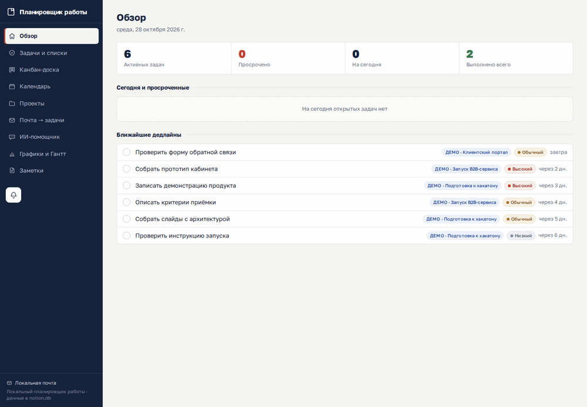
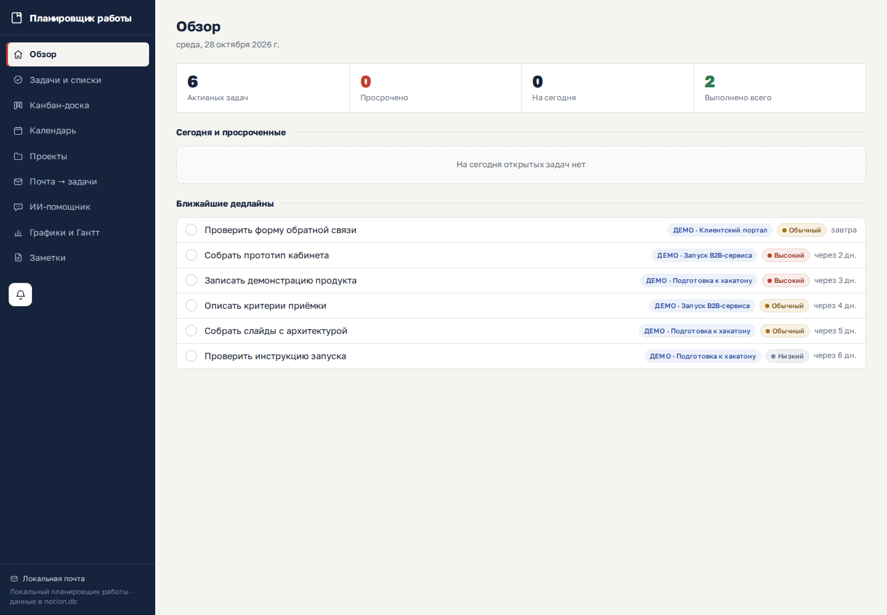
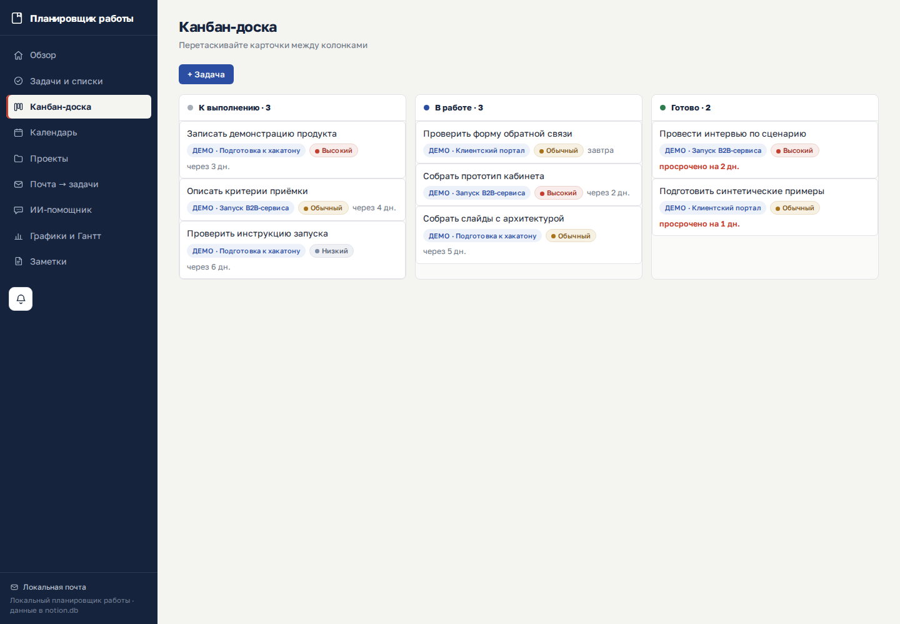
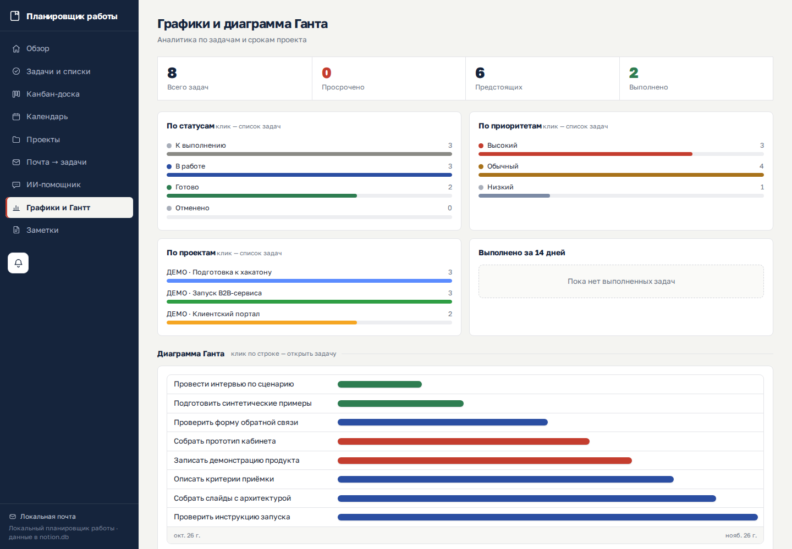
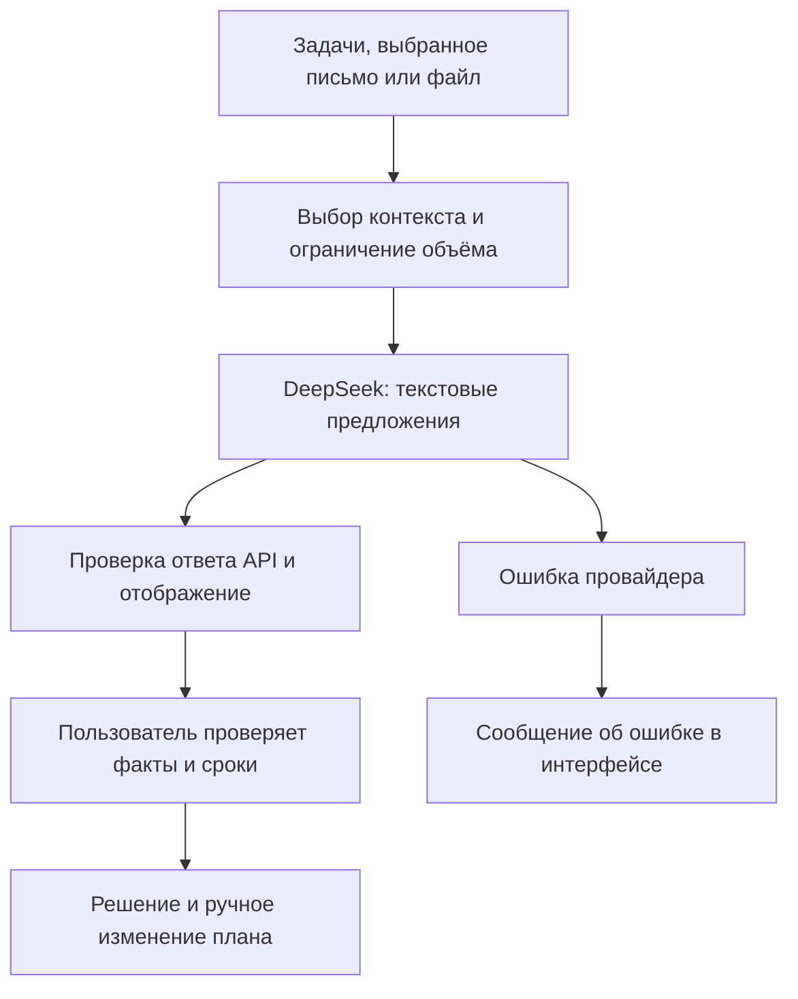

# my_crm — локальный планировщик с ИИ-помощником

Задачи, проекты и рабочая почта в одном локальном веб-интерфейсе. Проект создан для сокращения ручного переноса информации из писем в план работ.

**Статус:** личный прототип. Это отдельная обезличенная публикация с новой историей Git; в неё включён текущий код и синтетические демонстрационные материалы. Автор — [trollpom](https://github.com/trollpom), B2B-продакт. Фокус — веб-разработка, прикладной ИИ и автоматизация; проект создан с помощью ИИ и AI coding tools. Коммерческие внедрения и измеренная экономия времени не заявляются.


## Демонстрация для жюри

Реальный интерфейс локально запущенного приложения; все проекты, задачи и сроки синтетические. Рабочая почта не подключалась, платные запросы не выполнялись. Снимки от 28.10.2026.



GIF — последовательность трёх экранов основного сценария; это не запись живого запроса к LLM.

| Обзор | Канбан |
| --- | --- |
|  |  |



[Безопасная локальная демоверсия и сценарий показа](demo/README.md).

## Где работает ИИ



Помощник не подтверждает факты и не заменяет проверку человеком. Полноценная автоматическая проверка достоверности ответа не реализована. В безопасной демоверсии LLM отключена; показаны реальные функции планировщика, без имитации успешного ответа модели.


## Что реализовано

- Задачи и проекты: статусы, приоритеты, сроки, прогресс и журнал действий.
- Представления задач, канбан, календарь и диаграмма Ганта.
- Почта по IMAP: локальный кэш, поиск, цепочки писем, перенос информации в задачи и проекты.
- Заметки, вложения и локальные папки проектов.
- Помощник DeepSeek: чат по контексту, анализ писем и файлов, предложения для планирования.
- Отдельные CLI-скрипты для планирования, напоминаний, экспорта календаря и пересылки писем.

Наличие кода интеграции не подтверждает её настройку у конкретного пользователя. Чат и анализ требуют собственного ключа провайдера. Старые CLI-скрипты используют отдельный набор локальных файлов, а не основную SQLite-базу веб-приложения.

## Технологии

`Python 3.10+` · `FastAPI` · `Uvicorn` · `SQLite` · `JavaScript` · `HTML/CSS` · `IMAP` · `DeepSeek API`

## Быстрый запуск демонстрации

```bash
git clone https://github.com/trollpom/my_crm.git
cd my_crm
python -m venv .venv
# Windows: .venv\Scripts\activate
# macOS/Linux: source .venv/bin/activate
python -m pip install fastapi uvicorn requests pypdf
python demo/run_demo.py
```

Откройте http://127.0.0.1:8777/ . Демоверсия создаёт временную базу с тремя вымышленными проектами и восемью задачами. Почта и платный API отключены, рабочие файлы не копируются. Завершение — Ctrl+C.

Проверка запуска:

```bash
python demo/smoke_test.py
```

Для собственного постоянного локального экземпляра скопируйте `config.example.json` в игнорируемый `config.json` и запустите `python run.py`. В примере нет почтовых ящиков и ключа, ИИ отключён. База `notion.db` создаётся локально и не входит в репозиторий. Интерфейс доступен на http://127.0.0.1:8777/ .

## Как проверить за 3 минуты

1. Запустите `python demo/run_demo.py`.
2. Откройте «Обзор», затем карточку синтетической задачи.
3. Измените её статус и прогресс, проверьте канбан и Гант.
4. Откройте «Почта» и «ИИ-помощник»: рабочие ящики и ключ отсутствуют.
5. Выполните `python demo/smoke_test.py` для проверки HTTP, количества задач и отключённых интеграций.

## Подключение интеграций

Безопасные начальные настройки приведены в [config.example.json](config.example.json). Для почты добавьте в локальный `mailboxes` объект с полями `name`, `imap_server`, `imap_port`, `email`, `password`; для ИИ заполните локальный раздел `ai` и явно включите `enabled`. Добавляйте только собственный тестовый почтовый ящик и ключ DeepSeek в игнорируемый `config.json`. Приложение начинает фоновую синхронизацию настроенного ящика при старте.

При включении ИИ выбранные письма, задачи и содержимое анализируемых файлов могут передаваться внешнему провайдеру. Для демонстрации используйте вымышленные данные. CLI-пересылка и Telegram могут отправлять сообщения: запускайте их только после отдельной настройки и проверки получателей.

## Основные файлы

| Путь | Назначение |
| --- | --- |
| `run.py`, `app/main.py` | Запуск и HTTP API |
| `app/db.py` | SQLite и схема данных |
| `app/mail.py` | IMAP и кэш писем |
| `app/ai.py` | Запросы к модели и контекст |
| `app/static/` | Веб-интерфейс |
| `pm.py`, `pm_core.py`, `pm_mail.py` | Предыдущий CLI-планировщик |

## Ограничения и безопасность

Приложение предназначено для одного пользователя на `127.0.0.1`. Пользовательская авторизация и безопасное размещение в интернете не реализованы. Секреты хранятся в локальном JSON, без шифрования самим приложением; защищайте доступ к компьютеру и файлу. Для почты включена проверка TLS-сертификата. При ошибке сертификата нужно исправить цепочку доверия или адрес сервера.

Зависимости пока устанавливаются без зафиксированных версий. Нет полного набора автоматических тестов и подтверждённой проверки внешних интеграций. План улучшения: воспроизводимая установка, тесты бизнес-логики и развитие изолированной демоверсии.

Правила публикации: [SECURITY.md](SECURITY.md). [Состав обезличенной версии](docs/PRIVACY.md).

Проверка демонстрации: `python demo/smoke_test.py`.
